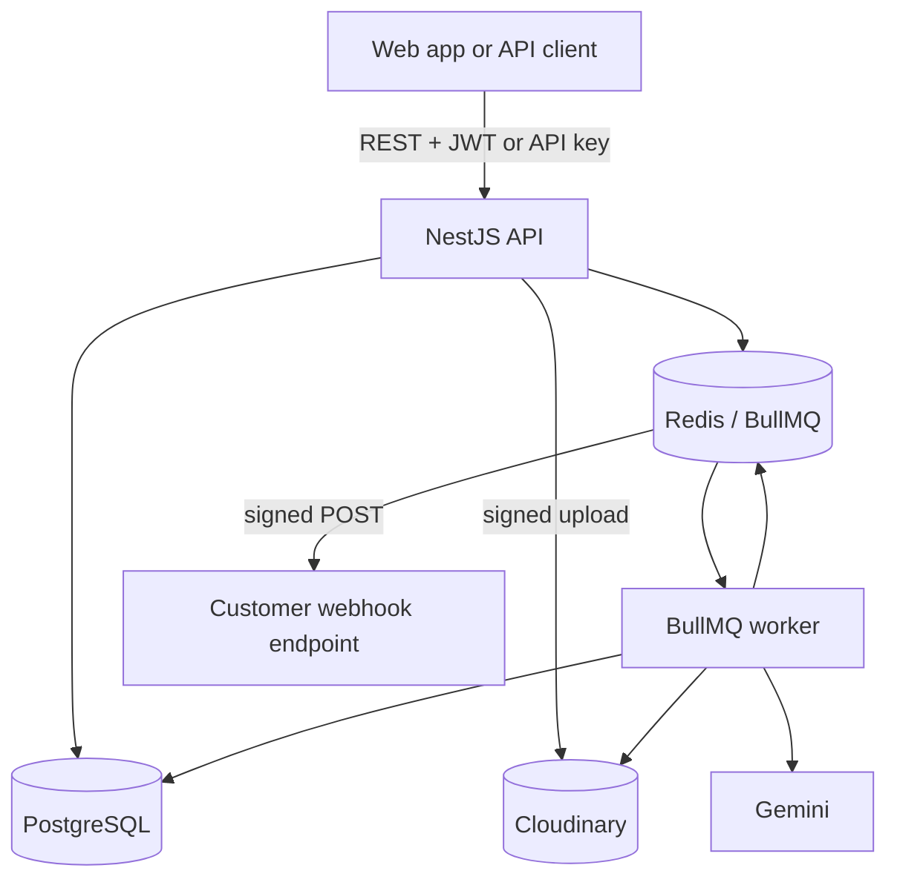

# Architecture

DocuFlow AI is a production-oriented document processing platform. This document
explains how the running system is assembled, which boundaries exist between
components, and how the design behaves under failure.

## System Context

The API never performs OCR or LLM calls inside a request. It validates access,
persists metadata, and enqueues work. The worker owns document downloads, model
calls, extraction validation, usage metering, and webhook dispatch.

## Runtime Components

| Component | Responsibility | Source |
| --- | --- | --- |
| Web | Next.js shell for the product UI | `apps/web` |
| API | Auth, tenancy, uploads, jobs, API keys, usage, webhook management, health | `apps/api` |
| Worker | Document processing, usage persistence, webhook delivery | `apps/worker` |
| Database | Relational source of truth and transactional state changes | `packages/database` |
| Observability package | JSON logging, OpenTelemetry bootstrap, readiness evaluation | `packages/observability` |
| Infrastructure | VPC, ALB, ECS Fargate, RDS, ElastiCache, S3, ECR, Secrets Manager | `infra/terraform` |
| End-to-end suite | Cross-service document lifecycle verification | `tests/e2e` |

## Request and Processing Flow

1. A user registers or logs in and receives a JWT access token.
2. The user creates an organization. Membership roles are `OWNER`, `ADMIN`,
   `DEVELOPER`, or `MEMBER`.
3. `POST /api/v1/documents/upload-url` validates the file type and size, creates
   a `PENDING_UPLOAD` document, and returns a signed Cloudinary upload payload.
4. The client uploads directly to Cloudinary.
5. `POST /api/v1/documents/:id/complete-upload` verifies the stored object
   metadata, marks the document `QUEUED`, creates a `ProcessingJob`, and adds a
   BullMQ job. Queue failures mark both records `FAILED` with `QUEUE_UNAVAILABLE`.
6. The worker claims the job with a compare-and-set update on the job status and
   attempt number. Duplicate deliveries therefore cannot process the same
   attempt twice.
7. The worker downloads the document, calls Gemini, validates the response with
   Zod, and writes the extraction, usage record, job status, and document status
   in one PostgreSQL transaction.
8. Completed or failed jobs enqueue webhook deliveries. Each delivery is signed
   with HMAC-SHA256 and retried independently.

Programmatic clients can use `POST /api/v1/documents/:id/process` with an API
key. Key management endpoints still require a user access token so a leaked
key cannot mint or revoke credentials.

## Data Model

| Entity | Purpose |
| --- | --- |
| `User` | Authentication identity |
| `Organization` | Tenant boundary |
| `Membership` | User role inside an organization |
| `Document` | Uploaded file metadata and lifecycle status |
| `ProcessingJob` | Attempt state and terminal failure details |
| `ExtractionResult` | Validated structured data, text, model, confidence |
| `UsageRecord` | Unique per job: tokens, duration, organization |
| `ApiKey` | SHA-256 hash, lookup prefix, revocation timestamp |
| `WebhookEndpoint` | URL, subscribed events, encrypted signing secret |
| `WebhookDelivery` | Event payload, status, attempt count |
| `WebhookDeliveryAttempt` | Per-attempt HTTP status and error |

`UsageRecord.jobId` is unique. Retries update the same record, so billing and
usage aggregation are idempotent.

## Reliability Model

- **Job retries:** three attempts with exponential backoff. Terminal failures
  persist `errorCode` and `errorMessage` and publish a failure webhook.
- **Validation retries:** malformed model output is retried; exhaustions become
  `INVALID_MODEL_RESPONSE`.
- **Idempotent enqueue:** active or completed jobs are returned instead of
  creating duplicates. Failed jobs are reused for retry.
- **Webhook retries:** five attempts, exponential backoff, ten-second timeout,
  redirects disabled, and full attempt history.
- **Circuit breaker:** ECS services use deployment circuit breakers with
  rollback enabled.
- **Graceful shutdown:** both services close HTTP, BullMQ, Prisma, Redis, and
  telemetry resources on `SIGTERM`.

## Security Boundaries

- Tenant data is always filtered by organization membership or the API key's
  organization.
- API key secrets use the `df_live_` prefix, are returned once, stored as a
  SHA-256 hash, and looked up by a non-secret prefix.
- Webhook signing secrets are encrypted with AES-256-GCM using
  `WEBHOOK_ENCRYPTION_KEY` or `JWT_SECRET`.
- Webhook URLs must use HTTPS and must not resolve syntactically to localhost,
  link-local, or private address ranges.
- Uploads are limited to PDF, JPEG, and PNG files up to 10 MiB; processing
  downloads are limited to 20 MiB.
- Logs redact authorization headers, API keys, signing secrets, passwords, and
  tokens.

## Observability

The API and worker emit JSON logs with `timestamp`, `level`, `service`,
`message`, `requestId`, `traceId`, `spanId`, and domain identifiers. Log level
is controlled with `LOG_LEVEL`.

OpenTelemetry starts only when `OTEL_EXPORTER_OTLP_ENDPOINT` or
`OTEL_EXPORTER_OTLP_TRACES_ENDPOINT` is configured. Manual spans cover HTTP
requests, document jobs, Gemini calls, and webhook deliveries. W3C trace context
is extracted from incoming requests.

Both services expose:

| Endpoint | Purpose |
| --- | --- |
| `GET /health` | Backwards-compatible liveness response |
| `GET /health/live` | Process liveness; no dependency calls |
| `GET /health/ready` | PostgreSQL and Redis readiness; `503` when degraded |

## Testing Layers

| Layer | Coverage | Command |
| --- | --- | --- |
| Unit | Logger redaction, readiness evaluation, schema behavior | `pnpm test` |
| Integration | Auth, tenancy, uploads, API keys, usage, webhooks, worker retries | `pnpm test` |
| End-to-end | Register → organization → upload → process → extraction → usage → revoke | `pnpm test:e2e` |
| Infrastructure | Terraform formatting and validation | Terraform workflow |

Integration and end-to-end suites require PostgreSQL and Redis. External
Cloudinary, Gemini, and webhook endpoints are replaced with deterministic local
servers.

## Design Trade-offs

- **PostgreSQL for state, Redis for transport.** Jobs can be retried without
  losing the durable status history.
- **Direct Cloudinary uploads.** The API avoids proxying large files; signed
  upload parameters prevent folder tampering.
- **Opaque API keys.** Hashing means a database leak does not expose usable
  credentials, at the cost of not being able to display a key again.
- **Async webhooks.** Callers get fast responses and delivery failures do not
  roll back processing, at the cost of eventual event delivery.
- **Opt-in telemetry.** Local development and tests do not need a collector,
  while production can export OTLP without code changes.
